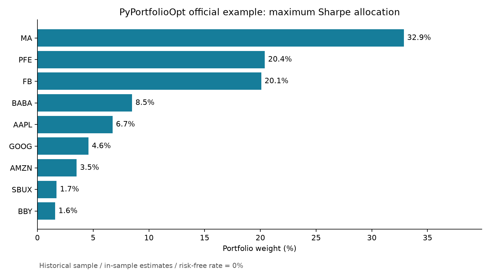

# PyPortfolioOpt：首次本地复现

这是使用开源库的学习练习，不是自行开发了 PyPortfolioOpt。上游项目：https://github.com/PyPortfolio/PyPortfolioOpt

## 运行记录

2026-11-06：在本地 Python 3.12 环境完成官方示例复现，使用 PyPortfolioOpt 1.6.0。环境配置和复现脚本由 AI 辅助完成，当前阶段是运行并学习官方示例。

数据包含 20 只股票、7,126 行，日期范围为 1989-12-29 至 2018-04-11，各股票有效历史长度不同。

| 样本内估算指标 | 结果 |
| --- | ---: |
| 年化收益率 | 29.94% |
| 年化波动率 | 21.76% |
| 夏普比率（无风险利率为 0%） | 1.38 |



已核对求解成功、原始权重合计为 100%、无负权重且绩效指标为有限数值。以上是复现结果，不构成样本外策略验证。

## 做了什么

复现官方 README 的最大夏普比率示例：读取官方历史股价数据，计算历史收益估计和样本协方差，求出不做空、权重总和为 100% 的投资组合。另将权重换算为假设 10,000 美元预算下的整数股数。

本例明确设无风险利率为 0%，一年按 252 个交易日计算。模型的收益和风险来自同一份历史样本，没有做样本外检验，不代表未来收益；未考虑交易费。官方数据中的不等长历史与缺失值沿用官方示例处理方式，不能视为已经完成真实投资数据清洗。

## 文件

- run_demo.py：可重新运行的 Python 程序。
- stock_prices.csv：上游 tests/resources/stock_prices.csv 的下载副本。
- weights.csv：股票配置比例。
- results.json：数据范围、软件版本、估算指标和整数股数。
- allocation.png：配置比例图。
- UPSTREAM_LICENSE.txt：上游 MIT 许可。

## 重新运行

这台电脑已将依赖放在当前工作区的 work/portfolio-packages，程序会优先加载该目录。
在其他电脑上，安装 Python 3.12 后，可在本目录运行：

```powershell
python -m pip install -r requirements.txt
python run_demo.py
```

## 先理解三个概念

- 权重：每只股票占总资金的比例。
- 波动率：收益变动幅度的衡量。
- 夏普比率：超出无风险收益的部分，除以组合波动率。本例无风险利率为 0%。

下一步可增加等权组合与最小波动组合，再使用较早数据确定权重，用较晚数据检验表现。暂时不应将本次示例称为完成了回测或原创投资策略。

## 来源

示例方法和数据来自 PyPortfolioOpt；上游 MIT 许可见 UPSTREAM_LICENSE.txt。
论文引用：Martin, R. A. (2021). PyPortfolioOpt: portfolio optimization in Python. Journal of Open Source Software, 6(61), 3066. https://doi.org/10.21105/joss.03066
